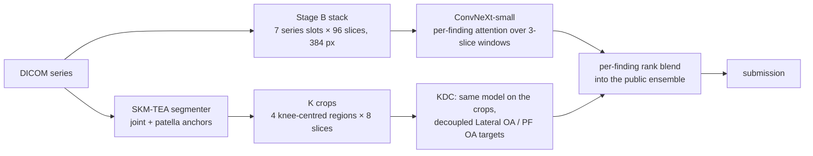

# RSNA Knee Abnormality Detection

Training and inference code for the [RSNA 2026 Knee Abnormality Detection](https://www.kaggle.com/competitions/rsna-knee-abnormality-detection)
Kaggle challenge: twelve findings per knee MRI study (ACL, MCL, medial / lateral meniscus, medial / lateral /
patellofemoral OA, effusion, synovitis, Baker's cyst, contusion, fracture), scored by macro AUROC.

The hard part is the labels. 4,407 training studies come with a free-text radiology report; only 58 carry grades read
from the images. The hidden test (~1,300 studies) is graded from the images. Every model here is therefore trained on
labels extracted from reports and judged against labels read from pixels.

## Results

| submission | public LB |
|---|--:|
| **Main final**: the public 0.958 ensemble (Raptor + R6 / R7) with our five ConvNeXt-small folds blended per finding | **0.957** |
| Main final + KDC on Lateral OA (below) | scoring |
| **OAI-free final**: R6 + R7 with our five folds trained only on report labels | **0.954** |
| Our five folds alone | 0.949 |

Single-finding probes isolate one finding's AUROC on the image-graded test (every other column held at 0.5):

| finding | our five folds (report labels) | KDC, one fold |
|---|--:|--:|
| Lateral OA | 0.896 | **~0.860**, with errors largely its own (ρ ≈ 0.5 with our folds) |
| PF OA | 0.896 | ~0.848 |
| Synovitis | 0.884 (fold 0 alone) | |
| Lateral Meniscus | 0.932 | |
| the other eight (mean) | ~0.966 | |

## Approach



**Input.** Each study becomes a fixed stack: seven series slots (three sagittal, two coronal, two axial), 96 slices
across each series, a 140 mm field at 384 px, every knee mirrored into the frame of a right knee. The same code builds
the training cache and runs at test time, and a fixture checks the two agree window for window.

**Model.** A ConvNeXt-small encoder reads 3-slice windows of the stack; a per-finding attention over windows decides
where each finding is read, and slot and depth embeddings tell the head which series and how deep. KDC adds a
per-finding attention over the positions inside each window (`--spatial-attn`). The trainer also supports mirroring
draws medial ↔ lateral with the paired targets swapped (`--mirror`, `--mirror-tta`).

**Labels.** A consensus of several public LLM readings of the reports, refined into soft targets by a teacher model.

**KDC.** Every report-trained model, ours and the public ones, scores the three OA compartments as one shared
"OA-ness": Lateral OA ~ Medial OA has a rank correlation of 0.82 in our predictions, against 0.32 in the radiologists'
grades. KDC trains on knee-centred crops with Lateral OA / PF OA labels masked so they no longer track the other
compartments. It is the one member of ours whose errors differ from the ensemble's, and it enters the final on
Lateral OA only.

**Submission.** A Kaggle notebook runs the public ensemble, then our stages, then a per-finding rank blend at weights
fixed before any run. Each stage checks every checkpoint's sha256, rebuilds a few training studies from their DICOMs
and compares them with the predictions they were scored with (the gate), and runs under a deadline. In the scored
rerun a failed or late stage leaves the submission it would have improved.

## Findings

- **The held-out report labels judge only "not broken".** They understated KDC by ~0.15 (0.711 held-out, ~0.860 on the
  image-graded board), against ~0.07 for a model trained on the coupled labels. A model built to disagree with the
  reports has to be judged on image-graded labels: here, single-finding probes.
- **A member helps only if its errors are its own.** At a base of 0.896 a member with within-class ρ 0.5 must reach
  ~0.84 alone to add +0.012 on its finding; at ρ 0.8 it must match the base. Stronger report-trained models (a ViT-L,
  denser slices, knee-centred crops on the same labels) did not beat it.
- **What did not move the weak findings:** read-time erasure of the shared factor (≤ 0.01), boosted trees on
  location-fixed cells of the crops (0.68–0.78), cartilage and meniscus measurements from the segmenter (0.62–0.65),
  further pseudo-label rounds, stronger LLM re-reads of the reports.

## Performance

Training runs DDP on two T4s under fp16 autocast with a fused AdamW, channels-last ConvNeXt kernels tuned by
`cudnn.benchmark`, pinned-memory loaders and non-blocking copies; losses and gradient norms stay on the device so the
host never stalls the GPU queue between steps. Inference decodes DICOMs in worker processes, one process per GPU, and
collects predictions on the device.

## Repository

```
fusion/       the model: train_windows.py (training), infer_windows.py (inference from DICOMs), scoring, folds
  runs_*/     held-out predictions of every trained fold (teacher, consensus, K, KDC) and two scoring controls
pipeline/     DICOM -> model input: the Stage B slice stack (slots96.py, build_slots64.py), K's crops (kcache.py)
labeling/     training targets: the report consensus and KDC's decoupled targets
kaggle/       builders that turn this code into Kaggle kernels: training, cache shards, submissions, the finals
tests/        offline tests on synthetic DICOM knees and synthetic predictions (no GPU, no Kaggle)
provenance/   pinned external inputs (sha256) and the site-grouped folds
docs/         experiment-log.md: every run, each with the rule written before it
```

## Usage

Python 3.12, `pip install -r requirements.txt`. Competition data and weights live on Kaggle (`data/` is git-ignored).

```bash
# train one fold of KDC on Kaggle
python kaggle/build_backbone_ab_kernel.py --arch convnext_small --corpus stage_k --folds 0 --n-train 0 \
    --recipe k --targets data/student/targets_teacher_v3_dc.csv \
    --targets-from raahimnawaz/rsna-knee-student-targets --tag kdc --out build/train
kaggle kernels push -p build/train

# score its held-out predictions against the teacher on the same studies
python fusion/score_oof.py fusion/runs_cnxs_teach1_f0/runs_convnext_small/fold0 \
    fusion/runs_kdc_f0/runs_convnext_small/fold0/avg3

# build the main final with KDC on Lateral OA, and its free CPU mount test
python kaggle/build_r6r7_kernel.py $PWD <public notebook dir> build/final --main958 \
    --wheel-pins kaggle/finals_wheel_pins.json --tag main-kdc \
    --k-weights-kernel <kdc kernels> --k-weights-sha <sha256s> --k-mix "Lateral OA=0.30"
python kaggle/build_finals_mounttest.py --final build/final --out build/mounttest
```

Offline tests:

```bash
python tests/public_blend_fixture.py
python tests/mirror_fixture.py --out /tmp/mirror
python tests/canon_fixture.py --out /tmp/canon && python tests/infer_parity_fixture.py --fixture /tmp/canon
python tests/stage_a_fixture.py
python pipeline/kcache.py --check
```

## Data and acknowledgements

Competition data, caches and weights are never committed. Outside data under a data-use agreement (OAI) never enters
this repository; the OAI-free final uses no model trained on it. The public ensemble is heliosli's R6 / R7 and nartaa's
Raptor; the report labels come from public LLM label tables (stevenleehans, pilkwang, lixin73, dreaddevelopment); the
knee segmenter is trained on SKM-TEA.
