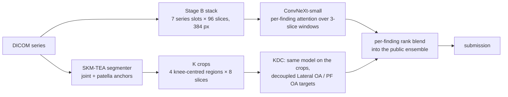

# RSNA Knee Abnormality Detection

Training and inference code for the [RSNA 2026 Knee Abnormality Detection](https://www.kaggle.com/competitions/rsna-knee-abnormality-detection)
Kaggle challenge: twelve findings per knee MRI study (ACL, MCL, medial / lateral meniscus, medial / lateral /
patellofemoral OA, effusion, synovitis, Baker's cyst, contusion, fracture), scored by macro AUROC.

The hard part is the labels. 4,407 training studies come with a free-text radiology report; only 58 carry grades read
from the images. The hidden test (~1,300 studies) is graded from the images. Our models in the official final were
therefore trained on labels extracted from reports and judged against labels read from pixels.

## Results

| submission | private score |
|---|--:|
| **Official final**: rank 482 of 6,425 (top 7.5%, bronze-medal range) | **0.943** |
| **After the close**, with better labels: would have placed about 167th (top 2.6%) | **0.946** |

**The official final** blends the public ensemble (nartaa's Raptor, heliosli's R6 / R7) with our five ConvNeXt-small
folds per finding, plus KDC on Lateral OA (below).

**After the close**, the same final with three changes to our five folds, each judged against a pass mark written
before its run (`docs/experiment-log.md`). Each moved the private score by 0.001, the smallest step the leaderboard
shows:

1. **Image-read labels.** The folds retrained from scratch on the mean of three LLM readings of the images, published
   by the 1st, 21st and 22nd-place teams, instead of labels taken from the reports
   (`labeling/build_image_read_targets.py`).
2. **Gold fine-tune.** One more epoch with the 58 image-graded studies repeated into the training set, then each fold
   blended a quarter of the way back to its starting weights.
3. **Header de-bias.** A model that sees only the DICOM headers (scanner, protocol, series names) predicts the report
   labels well above chance: that is site and reporting style, not anatomy. A fixed share of its prediction is
   subtracted from the submission (`pipeline/header_prior.py`).

Our five folds alone, with these changes and no public model, score 0.944.

## Approach



**Input.** Each study becomes a fixed stack: seven series slots (three sagittal, two coronal, two axial), 96 slices
across each series, a 140 mm field at 384 px, every knee mirrored into the frame of a right knee. The same code builds
the training cache and runs at test time, and a fixture checks the two agree window for window.

**Model.** A ConvNeXt-small encoder reads 3-slice windows of the stack; a per-finding attention over windows decides
where each finding is read, and slot and depth embeddings tell the head which series and how deep. KDC adds a
per-finding attention over the positions inside each window (`--spatial-attn`). The trainer also supports mirroring
draws medial ↔ lateral with the paired targets swapped (`--mirror`, `--mirror-tta`).

**Labels.** A consensus of several public LLM readings of the reports, refined into soft targets by a teacher model.
After the close: the mean of three LLM readings of the images (Results).

**KDC.** Every report-trained model, ours and the public ones, scores the three OA compartments as one shared
"OA-ness": Lateral OA ~ Medial OA has a rank correlation of 0.82 in our predictions, against 0.32 in the radiologists'
grades. KDC trains on knee-centred crops with Lateral OA / PF OA labels masked so they no longer track the other
compartments. It is the one member of ours whose errors differ from the ensemble's, and it enters the final on
Lateral OA only.

**Submission.** A Kaggle notebook runs the public ensemble, then our stages, then a per-finding rank blend at weights
fixed before any run. Each stage checks every checkpoint's sha256, rebuilds a few training studies from their DICOMs
and compares them with the predictions they were scored with (the gate), and runs under a deadline. In the scored
rerun a failed or late stage leaves the submission it would have improved.

## Findings

- **The held-out report labels judge only "not broken".** Against the image-graded test they understated KDC more
  than a model trained on the coupled labels. A model built to disagree with the reports has to be judged on
  image-graded labels: here, submissions that score one finding alone.
- **A member helps only if its errors are its own.** At a base AUROC of ~0.90 a member with within-class ρ 0.5 must
  reach ~0.84 alone to add +0.012 on its finding; at ρ 0.8 it must match the base. Stronger report-trained models (a
  ViT-L, denser slices, knee-centred crops on the same labels) did not beat it.
- **What did not move the weak findings:** read-time erasure of the shared factor (≤ 0.01), boosted trees on
  location-fixed cells of the crops (0.68–0.78), cartilage and meniscus measurements from the segmenter (0.62–0.65),
  further pseudo-label rounds, stronger LLM re-reads of the reports.

## Next steps

1. **Option B: the image reads as the top teams trained on them.** They did not train on the raw reads. 2nd place
   kept half the report's value for PF OA, where the reports name kneecap cartilage damage the image reads underrate,
   and mixed its own models' predictions back into the labels: 30% on ACL, MCL, both menisci, PF OA and Lateral OA,
   60% on the other six. The same labels are built here with our folds' held-out predictions
   (`labeling/build_imgread_mix_targets.py`). Retraining the five folds and fine-tuning them takes ~21–23 GPU hours.
   Pass mark, set before the run: our folds alone at 0.947 or more, three steps above the image reads alone.
2. **The final without the header de-bias.** The de-bias removes habits learned from report labels; with our folds
   now trained on image reads it may no longer help. Pass mark: 0.947 or more. One short GPU run.
3. **Later:** a second round with the image-read folds as the teacher; KDC retrained on the image-read labels; 1st
   place's region-of-interest pooling.

## Performance

Training runs DDP on two T4s under fp16 autocast with a fused AdamW, channels-last ConvNeXt kernels tuned by
`cudnn.benchmark`, pinned-memory loaders and non-blocking copies; losses and gradient norms stay on the device so the
host never stalls the GPU queue between steps. Inference decodes DICOMs in worker processes, one process per GPU, and
collects predictions on the device.

## Repository

```
fusion/       the model: train_windows.py (training), infer_windows.py (inference from DICOMs), scoring, folds
  runs_*/     held-out predictions of every trained fold (teacher, consensus, K, KDC, image-read) + scoring controls
pipeline/     DICOM -> model input: the Stage B slice stack (slots96.py, build_slots64.py), K's crops (kcache.py),
              the header prior behind the de-bias (header_prior.py)
labeling/     training targets: the report consensus, KDC's decoupled targets, the image-read targets, option B's mix
kaggle/       builders that turn this code into Kaggle kernels: training, cache shards, submissions, finals, de-bias
tests/        offline tests on synthetic DICOM knees and synthetic predictions (no GPU, no Kaggle)
provenance/   pinned external inputs (sha256) and the site-grouped folds
docs/         experiment-log.md: every run, each with the rule written before it
```

## Usage

Python 3.12, `pip install -r requirements.txt`. Competition data and weights live on Kaggle (`data/` is git-ignored).

```bash
# train one fold of KDC on Kaggle
python kaggle/build_backbone_ab_kernel.py --arch convnext_small --corpus stage_k --folds 0 --n-train 0 \
    --recipe k --targets data/student/targets_teacher_v3_dc.csv \
    --targets-from raahimnawaz/rsna-knee-student-targets --tag kdc --out build/train
kaggle kernels push -p build/train

# score its held-out predictions against the teacher on the same studies
python fusion/score_oof.py fusion/runs_cnxs_teach1_f0/runs_convnext_small/fold0 \
    fusion/runs_kdc_f0/runs_convnext_small/fold0/avg3

# build the main final with KDC on Lateral OA, and its free CPU mount test
python kaggle/build_r6r7_kernel.py $PWD <public notebook dir> build/final --main958 \
    --wheel-pins kaggle/finals_wheel_pins.json --tag main-kdc \
    --k-weights-kernel <kdc kernels> --k-weights-sha <sha256s> --k-mix "Lateral OA=0.30"
python kaggle/build_finals_mounttest.py --final build/final --out build/mounttest

# build the image-read labels from the three published read tables
python labeling/build_image_read_targets.py
```

Offline tests:

```bash
python tests/public_blend_fixture.py
python tests/mirror_fixture.py --out /tmp/mirror
python tests/canon_fixture.py --out /tmp/canon && python tests/infer_parity_fixture.py --fixture /tmp/canon
python tests/stage_a_fixture.py
python tests/debias_fixture.py
python tests/gold_finetune_fixture.py
python pipeline/kcache.py --check
```

## Data and acknowledgements

Competition data, caches and weights are never committed. Outside data under a data-use agreement (OAI) never enters
this repository. The public ensemble is heliosli's R6 / R7 and nartaa's Raptor; the report labels come from public LLM
label tables (stevenleehans, pilkwang, lixin73, dreaddevelopment); the knee segmenter is trained on SKM-TEA. The image
reads are published by the 1st (Team Kangaroo, tascj0), 21st (Driz Lo, drizlo) and 22nd (matsurihime) place teams
under CC BY 4.0. Option B follows 2nd place MURAD's write-up (azamat1ch/rsna-knee-2nd-place, CC BY-NC 4.0),
re-implemented without its code; the header de-bias follows the 228th-place write-up.
